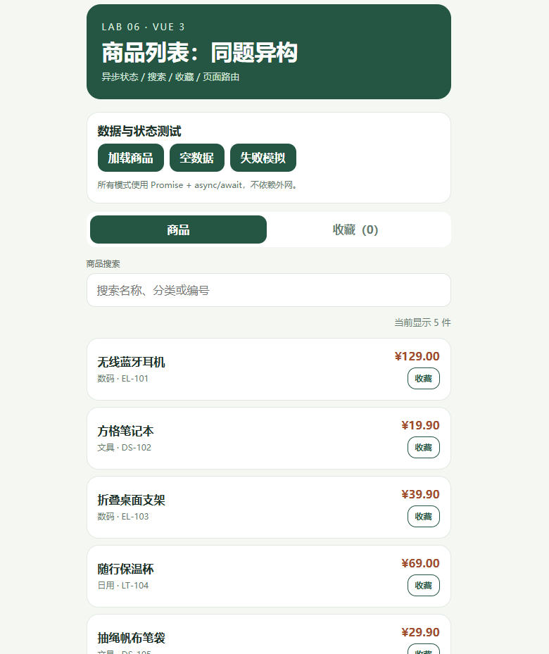
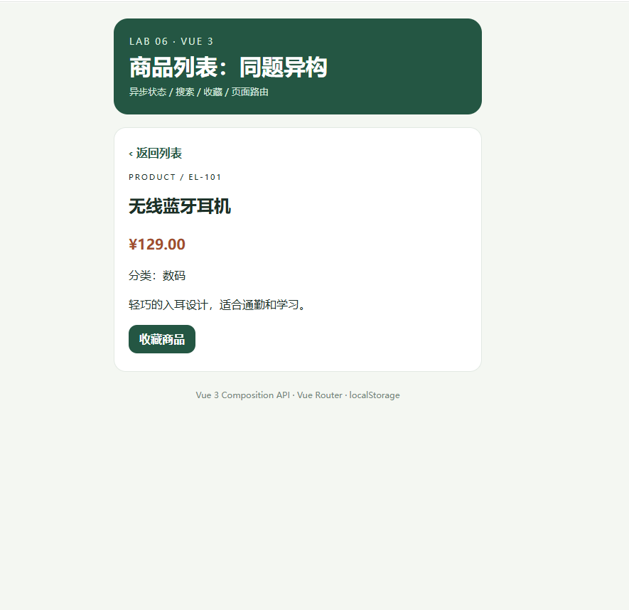
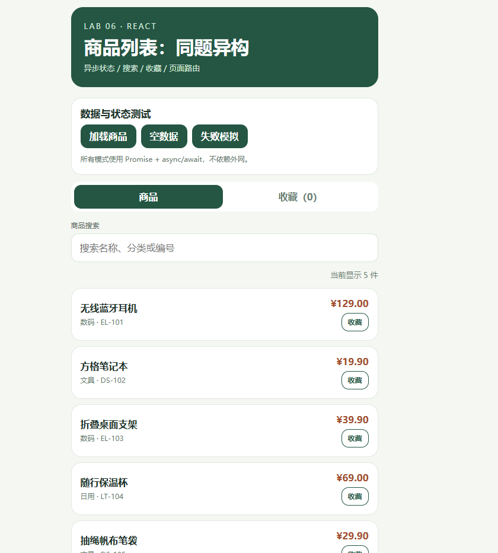
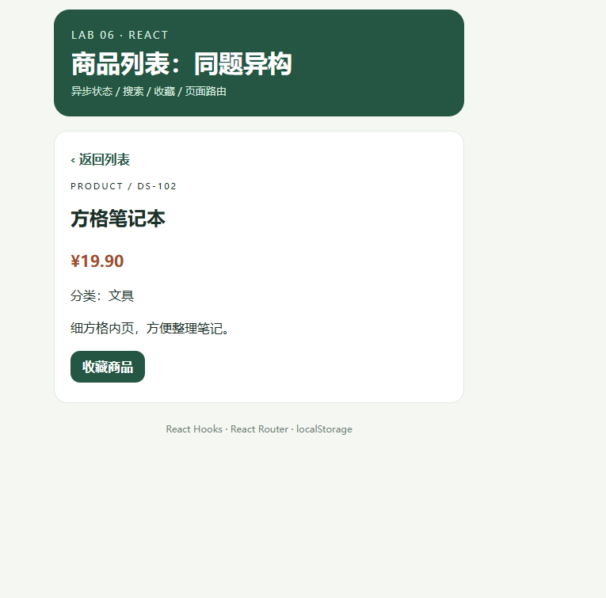
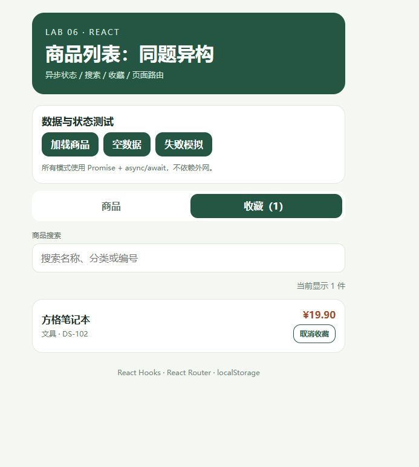
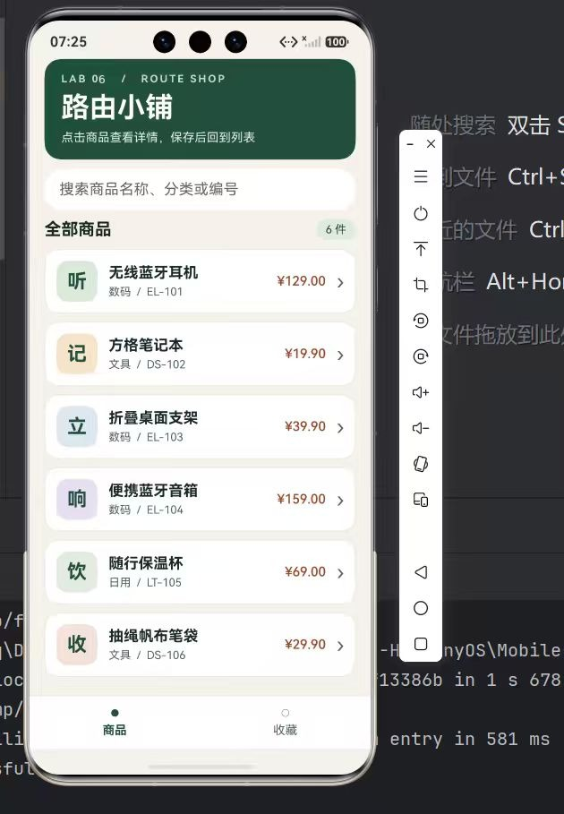

# 移动开发实验六：ArkTS、Vue 3 与 React 对比实践

本实验在 HarmonyOS ArkTS / ArkUI 商品应用的基础上，分别使用 Vue 3 和 React 实现同一组交互功能，比较三种技术栈在组件组织、状态管理、异步调用、路由和本地存储方面的差异。

## 实验内容

- **概念映射**：对照 ArkUI、Vue 3 和 React 的组件、状态、事件、生命周期与路由。
- **同题异构**：实现商品列表、名称搜索、商品详情、收藏，以及异步加载中的成功、空数据和失败状态。
- **概念讲解**：用费曼学习法解释组件、状态、异步、路由和本地持久化。
- **技术选型**：从语言、UI 范式、性能与生态等方面分析适用场景。
- **互评反馈**：给出具体优点和可执行的修改建议。

## 项目结构

| 路径 | 内容 |
| --- | --- |
| `harmonyos-reference/` | 原生 ArkTS / ArkUI 项目，使用 DevEco Studio 运行 |
| `vue3-product-demo/` | Vue 3、Vue Router、Composition API 实现 |
| `react-product-demo/` | React Hooks、React Router 实现 |
| `docs/实验六_技术对比与讲解.md` | 概念映射、费曼讲解、技术选型与互评 |
| `docs/同题功能说明.md` | 统一功能范围与测试场景 |
| `docs/平台提交摘要.md` | 平台提交用内容摘要 |

## 环境与运行

### HarmonyOS

使用 DevEco Studio 打开 `harmonyos-reference/`，选择 `entry` 运行到 HarmonyOS 模拟器。原生版本使用 NetworkKit 请求数据，通过 Preferences 保存收藏。

### Vue 3

需要 Node.js 22 或 24 LTS。进入 `vue3-product-demo/` 后执行：

```bash
npm install
npm run dev
```

### React

新开终端，进入 `react-product-demo/`，执行：

```bash
npm install
npm run dev
```

两个 Web 项目分别以终端输出的 `Local` 地址为准，通常为 `http://localhost:5173/` 和 `http://localhost:5174/`。执行 `npm test` 可运行基础数据与异步状态测试；`npm run build` 用于生成构建产物。

## 功能验证

1. 打开商品列表，输入商品名称或分类进行筛选。
2. 点击商品进入详情，查看名称、价格和说明。
3. 收藏商品并返回列表，切换到「收藏」页面确认结果。
4. 刷新 Web 页面或重启原生应用，检查收藏是否保留。
5. 分别触发加载中、加载成功、空数据和失败状态，确认提示与重试操作。

Vue 和 React 版本使用相同的本地商品数据和模拟异步方法，方便对比组件写法。Web 收藏使用 `localStorage`，ArkTS 收藏使用 `Preferences`；两者具有相近的存储目的，但运行环境与接口并不相同。


## 运行截图

| 运行场景 | 截图 |
| --- | --- |
| Vue 3：商品列表 |  |
| Vue 3：商品详情 |  |
| React：商品列表 |  |
| React：商品详情 |  |
| React：刷新后保留收藏 |  |
| ArkTS：商品列表 |  |
