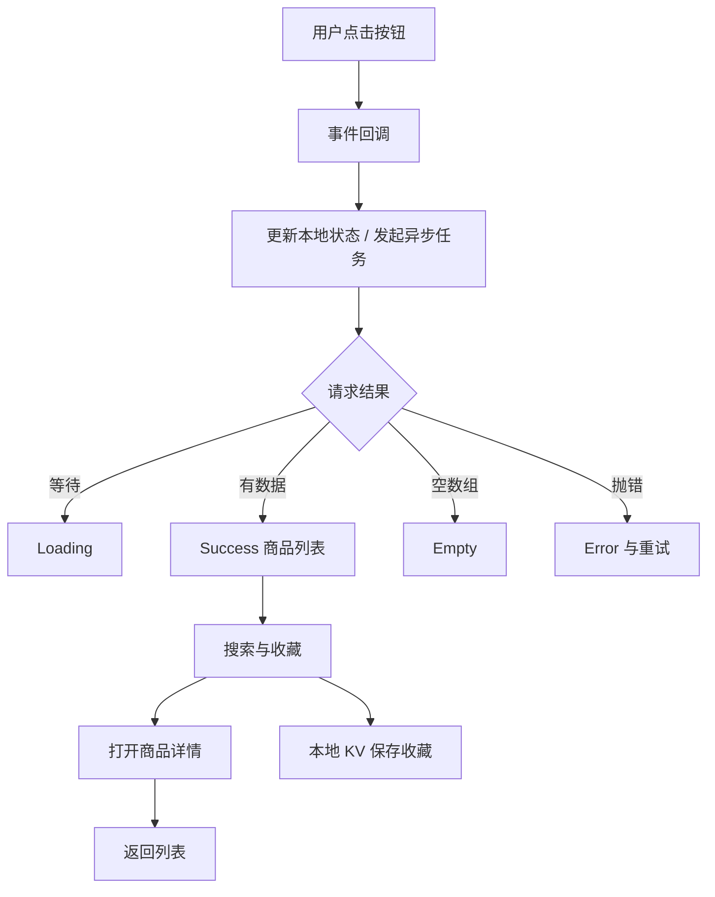

# 实验六：从 ArkTS 到 Vue 3 与 React 的概念迁移

## 一、实验目标和比较对象

前五次实验主要使用 **HarmonyOS 原生 ArkTS / ArkUI**，完成了组件布局、列表搜索、点击事件、页面跳转、异步请求以及 Preferences 本地保存。本次选择 **Vue 3（Composition API）** 和 **React（函数组件 + Hooks）** 作为另外两套框架，研究相同交互在不同技术体系中的实现方式。

对照题目为：**商品列表通过异步方法加载，支持搜索和详情查看，可以将商品加入收藏，并在刷新或重启后恢复收藏记录。** 两个 Web 工程均包含加载成功、空数据和失败模拟，使用相同的五件商品及 650ms 异步延时。这里的延时用于展示 Promise 状态，并不冒充真实网络请求；实验五 ArkTS 原工程仍保留了真实 HTTPS 接口测试入口。

## 二、概念映射（Concept Mapping）

| 已学概念 | ArkTS / ArkUI | Vue 3 | React | 关键区别 |
| --- | --- | --- | --- | --- |
| 编程语言 | ArkTS（受约束的 TypeScript 方言） | JavaScript / TypeScript | JavaScript / TypeScript + JSX | 三者可用类型化思路，但工具链不同 |
| UI 声明 | `@Component` + `build()` + `Column/Row/Text` | SFC 的 `<template>` | 函数组件返回 JSX | 都是声明“状态对应的界面”，语法不同 |
| 组件输入 | `@Prop` 等属性 | `defineProps()` | 函数参数 `props` | 子组件均接收父组件数据，更新约束有差异 |
| 组件事件 | `.onClick(() => ...)` | `@click="..."` | `onClick={...}` | 对同一事件的绑定语法不同 |
| 可变状态 | `@State` | `ref()` / `reactive()` | `useState()` | Vue 用响应式依赖跟踪；React 通过状态更新触发重新渲染 |
| 派生数据 | 普通方法 / 状态驱动视图 | `computed()` | `useMemo()` 或渲染时计算 | `computed` 自带依赖追踪；`useMemo` 是可选的缓存优化 |
| 列表渲染 | `ForEach`，指定稳定 key | `v-for` + `:key` | `.map()` + `key` | 都需要稳定 ID 来保持列表项身份 |
| 条件渲染 | `if/else` | `v-if/v-else` | JSX 三元表达式或 `&&` | 不同写法，都能表达 Loading/Empty/Error |
| 生命周期 | `aboutToAppear()` 等 | `onMounted()` / `onUnmounted()` | `useEffect()` 的 setup/cleanup | 触发时机和使用限制不能完全等同 |
| 异步请求 | `Promise` / `async-await`，NetworkKit | `fetch` / Promise + `watch` | `fetch` / Promise + `useEffect` | Promise 思路相似，触发和取消旧请求方式不同 |
| 页面路由 | `Navigation` + `NavPathStack.pushPathByName/pop` | Vue Router 的 `router.push/back` | React Router 的 `navigate(...)` | ArkTS 是原生 NavDestination 栈，Web 是 URL/浏览器历史 |
| Tab 切换 | `TabsController.changeIndex()` | `ref` 切换当前面板 | `useState` 切换当前面板 | 此实验的 Tab 切换不新增普通页面路由 |
| 本地 KV | `Preferences` + `put/flush` | `localStorage.setItem` | `localStorage.setItem` | 都可存非敏感偏好；API、作用域和持久化机制不同 |
| 依赖与构建 | DevEco Studio / Hvigor | Vite + Vue 插件 | Vite + React 插件 | 不同平台的运行环境及打包目标不同 |

从映射表看，**可迁移的是思考问题的方法**：先定义数据和状态，再处理事件、异步结果、页面组织及持久化。不能简单把 ArkTS 的装饰器逐字替换成 Vue 或 React 的某个函数，例如 `@State` 和 `useState` 的调度及重新渲染语义并不完全一样。

### 一张简化的概念关系图



## 三、同题异构的实际实现

三个项目的功能边界一致，但实现方式不同。**`harmonyos-reference/`** 是之前实验五的原生 ArkTS 工程；**`vue3-product-demo/`** 和 **`react-product-demo/`** 是本次编写的两套可运行 Web 工程。

### 1. ArkTS：原生页面与状态

原工程主要代码位置：

- `entry/src/main/ets/pages/Index.ets`：`@State` 保存列表、筛选和加载状态，UI 使用 `if/else` 呈现四种状态。
- `entry/src/main/ets/service/ProductService.ets`：`async/await` 获取数据并转换为商品类型。
- `entry/src/main/ets/pages/ProductDetail.ets`：通过 `NavDestination` 获取详情参数，返回时使用 `pop(result)`。
- `entry/src/main/ets/store/ProductPreferences.ets`：本地写入收藏 ID，并调用 `flush()`。

它适合直接在 HarmonyOS 手机模拟器上运行，可以使用系统的 Navigation、Tabs 和设备 API。

### 2. Vue 3：用 `ref` 和 `computed` 管理视图

核心片段（`vue3-product-demo/src/views/CatalogView.vue`）：

```javascript
const query = ref('')
const mode = ref('success')
const items = ref([])
const state = ref('loading')

watch(mode, async () => {
  state.value = 'loading'
  try {
    items.value = await loadProducts(mode.value)
    state.value = items.value.length ? 'success' : 'empty'
  } catch {
    state.value = 'error'
  }
})
const shown = computed(() => filterProducts(items.value, query.value))
```

项目完整代码还加入请求编号，避免先前的慢请求覆盖后发请求；上面仅保留关键概念。Vue 模板用 `v-model` 同步搜索框，`v-for` 展示商品，用 `router.push()` 打开详情。收藏状态放在共享的响应式模块中，并写入 `localStorage`。

### 3. React：用 Hooks 描述状态与副作用

核心片段（`react-product-demo/src/App.jsx`）：

```jsx
const [items, setItems] = useState([])
const [mode, setMode] = useState('success')
const [status, setStatus] = useState('loading')

useEffect(() => {
  let cancelled = false
  setStatus('loading')
  loadProducts(mode).then(result => {
    if (cancelled) return
    setItems(result)
    setStatus(result.length ? 'success' : 'empty')
  }).catch(() => {
    if (!cancelled) setStatus('error')
  })
  return () => { cancelled = true }
}, [mode])
```

完整工程用 `async/await` 写法实现同一过程，示例片段则展示 Promise 也能和 `useEffect` 协作。`useState` 管理变化，`useMemo` 派生筛选结果，React Router 的 `useNavigate()` 负责打开商品详情；收藏由 Context 提供给列表和详情。

### 4. 两种路由不能混为一谈

**普通页面跳转**：从商品列表进入详情，屏幕不再显示列表，返回时恢复列表。ArkTS 使用 `NavPathStack.pushPathByName()` / `pop()`；Vue 使用 `router.push()` / `router.back()`；React 使用 `navigate('/product/ID')` / `navigate(-1)`。

**Tab 切换**：在商品与收藏两个面板之间切换，这里不需要往历史栈里压入一个新详情页。ArkTS 对应 `TabsController.changeIndex()`；Vue 用 `activeTab.value`；React 用 `setTab()`。如果业务要求每个 Tab 拥有独立 URL，也能在 Web 中使用路由实现，但不是本实验的演示方案。

## 四、费曼学习法：讲给没写过代码的同学听

**组件是什么？** 可以把页面看成拼积木。一个商品卡片就是一块积木，里面放名字、价格和收藏按钮。商品列表只是把这块积木重复摆好。下次换样式，只改积木的写法，不必修改每一行商品。

**状态是什么？** 页面像一块能自动改字的电子价签。`@State`、`ref`、`useState` 都是在说“这个值一变，界面也应该跟着变”。如果收藏从 `false` 变成 `true`，按钮文字就应该从“收藏”变成“取消收藏”。区别只在于框架怎样发现、安排和执行更新。

**为什么异步要分四种情况？** 点外卖后不可能立刻拿到饭：下单等待是 Loading，收到饭是 Success，商家告知没有商品是 Empty，配送出故障是 Error。异步请求也一样。把这几种结果分开写，用户才知道应该等、查看数据还是重试。

**Promise 是什么？** 就像领取一个取餐号：现在得到的是一个“将来有结果”的承诺，而不是饭本身。`await` 表示先等这个承诺完成，再处理结果；等待期间其他界面工作仍可继续。

**路由是什么？** 普通页面跳转类似翻到书的另一页，再按返回翻回来；Tab 更像一个资料夹上面的几个标签，点一下换显示的内容，不一定翻到新的历史页面。实现时必须先判断用户动作属于哪一种。

**为什么要保存本地数据？** 如果只把收藏放在组件变量里，退出应用就像擦掉白板。Preferences 或 localStorage 相当于放进抽屉，下次打开还能读到。但抽屉不是保险柜，所以不能把密码和未加保护的访问令牌放进去。

**为什么要防止旧请求覆盖新请求？** 搜索“蓝牙”后立刻改搜“文具”，第一份请求可能比第二份更晚回来。如果不区分请求先后，界面可能显示过时结果。给请求编号或在副作用清理时标记取消，才能只接受当前这次请求的数据。

**为什么三个框架都能完成同一题？** 因为商品、搜索条件、加载结果和收藏标记是业务问题；`@State`、`ref` 和 `useState` 只是不同的工具。先想清楚业务流程，才容易换工具。

## 五、技术选型分析

| 维度 | ArkTS / ArkUI | Vue 3 | React |
| --- | --- | --- | --- |
| 语言 | ArkTS，接近 TypeScript，规则更严格 | JavaScript 或 TypeScript | JavaScript 或 TypeScript + JSX |
| UI 范式 | 原生声明式组件，直接接入 HarmonyOS UI 能力 | 模板驱动，HTML 结构清晰 | JavaScript 驱动 JSX，组合函数和组件自由度高 |
| 状态管理 | 组件状态装饰器以及系统状态能力 | `ref`/`reactive`/`computed`，大型应用可选 Pinia | Hooks/Context，大型应用可选择生态状态库 |
| 异步 | Promise、`async/await` 与 NetworkKit | Promise、`fetch`、watch / 生命周期 | Promise、`fetch`、`useEffect` 或数据请求库 |
| 路由 | 系统 Navigation / NavPathStack | Vue Router | React Router |
| 生态 | HarmonyOS 原生能力、DevEco 工具链 | Vue 社区、组件库、Vite 生态 | React 组件与工具生态、多端方案丰富 |
| 适用场景 | 重点面向 HarmonyOS 原生手机能力 | 后台管理系统、移动 Web、小团队 Web 项目 | 大中型 Web 应用、复杂组件共享及长期扩展 |

### 选型理由

如果项目目标明确为 **HarmonyOS 原生应用**，需要系统窗口、设备权限或原生导航效果，优先 ArkTS：集成系统能力直接，调试工具也更针对 HarmonyOS。但它不能把原生页面代码直接丢到普通浏览器里运行。

如果项目主要是 **Web 页面**，且团队希望把页面结构与业务逻辑分开，Vue 3 更容易上手。它的模板和 `computed` 对表单、列表和筛选等场景很直观。

如果项目是 **复杂 Web 产品**，有大量可复用交互组件、跨团队设计体系，并且团队熟悉 JavaScript 函数式写法，React 的 Hooks 和 JSX 较灵活。但 `useEffect` 的依赖及清理逻辑需要严格维护，否则可能出现重复请求或过期结果。

本实验的单一商品列表在三套技术中都能做得很轻量。因此选择标准不是“哪套一定更先进”，而是**目标运行平台、团队已有经验、组件复用需求、系统 API 依赖和维护成本**。

## 六、互评：先肯定，再给可执行建议

以下是适用于互评的写法示例，描述的是对代码可能出现的问题的检查方法，并不声称已经评价某位同学。

**示例一：Vue 作品**

> 你的商品搜索使用 `computed` 处理派生数据，逻辑比较集中；列表也给了稳定的商品 ID，后续增加分类筛选会很方便。建议下一步在加载接口的地方加入请求序号：连续点“加载商品”和“失败演示”时，只接收最后一次请求的结果。可以连点三次按钮验证界面不会被旧结果覆盖。

**示例二：React 作品**

> 你把收藏功能抽成了独立的 Hook 或 Context，列表与详情能复用同一份状态，这一点很清楚。建议在 `useEffect` 的异步加载中补充 cleanup，并为“空数据”和“请求失败”写出不同提示。验收时可以快速切换请求模式，再直接刷新页面检查收藏是否恢复。

**收到建议后如何修改**：先复现对方说的场景；在对应文件做最小修改；重跑测试；回复“已按建议补充了什么，以及哪一步证明已解决”。反馈应该可定位、可操作、可验证，而不是只写“代码不错”或“要优化”。

## 七、运行步骤与验收结论

Vue 3 和 React 项目分别进入各自文件夹执行：

```bash
npm install
npm run dev
```

浏览器打开命令行显示的本地地址。页面加载后依次执行成功、空数据、错误模拟、搜索“文具”、打开详情、收藏、刷新等操作，逐项比对 `同题功能说明.md` 的用例。

还可以执行：

```bash
npm test
npm run build
```

这两条命令分别检查纯函数/异步逻辑与前端构建。ArkTS 参照工程在 DevEco Studio 中打开并启动 `entry`，与实验五的方法一致。

**结论**：三套技术都遵循“事件 → 状态 → 更新界面”的思路。异步状态、路由、存储等问题在概念上可迁移，但框架 API、生命周期、路由历史及平台能力并不相同。本次真正有收获的不是记下三组语法，而是能先独立描述需求，再在另一套框架中重新组织代码。

## 官方参考资料

- [HarmonyOS Navigation 组件与 NavPathStack](https://developer.huawei.com/consumer/en/doc/harmonyos-guides/arkts-navigation-architecture/)
- [Vue 3 Composition API](https://vuejs.org/guide/extras/composition-api-faq)
- [Vue 3 生命周期](https://vuejs.org/api/composition-api-lifecycle.html)
- [React `useState`](https://react.dev/reference/react/useState)
- [React `useEffect`](https://react.dev/reference/react/useEffect)
- [Vue Router 编程式导航](https://router.vuejs.org/guide/essentials/navigation.html)
- [React Router `useNavigate`](https://reactrouter.com/api/hooks/useNavigate)
- [HarmonyOS Preferences 本地持久化](https://developer.huawei.com/consumer/cn/doc/harmonyOS-guides/data-persistence-by-preferences/)
- [Vite 开发与构建](https://vite.dev/guide/)
